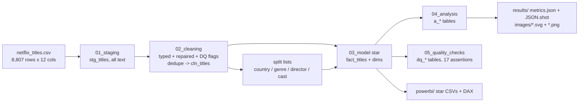
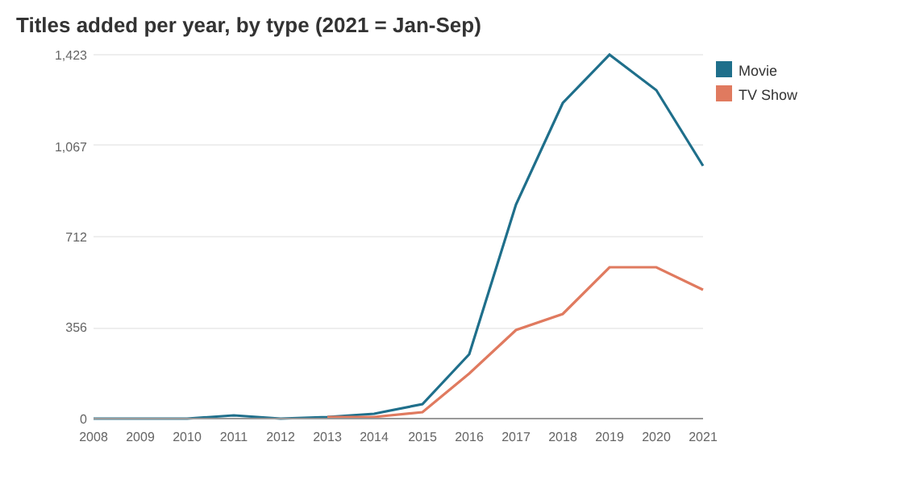
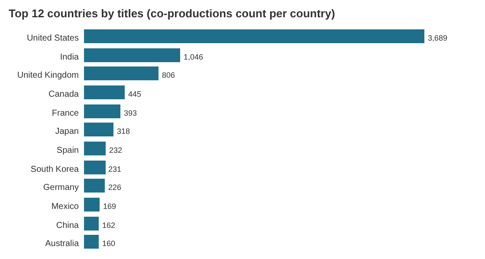
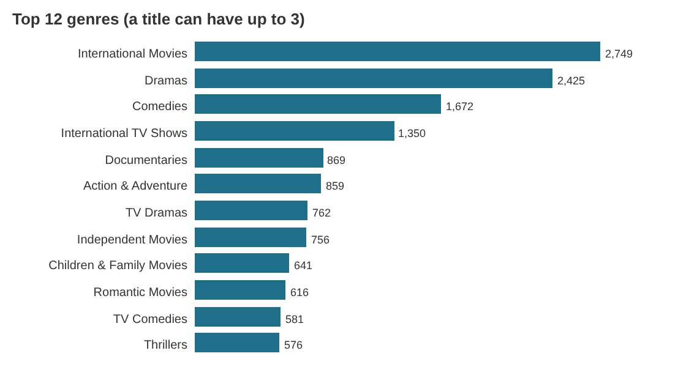
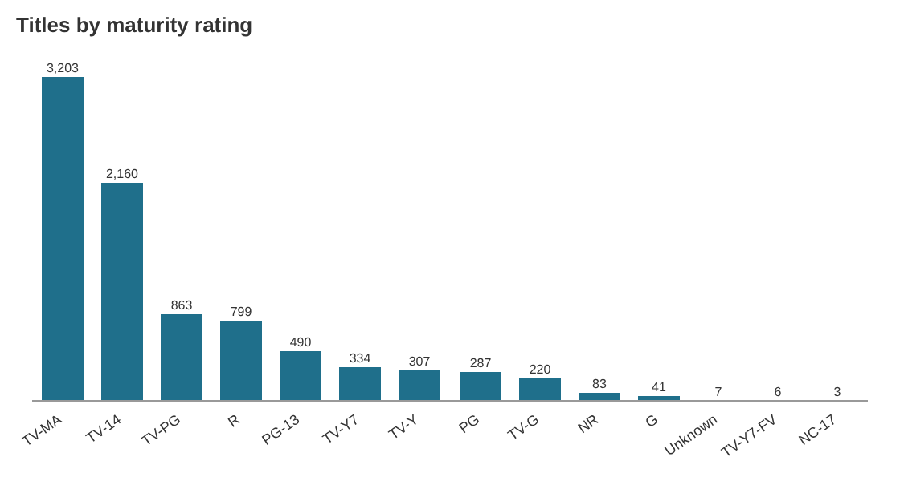
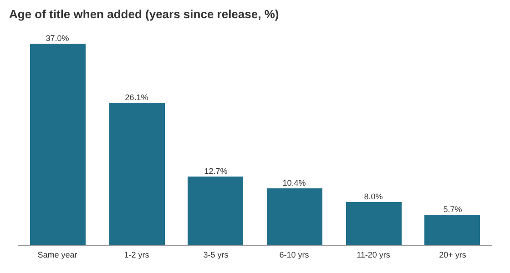
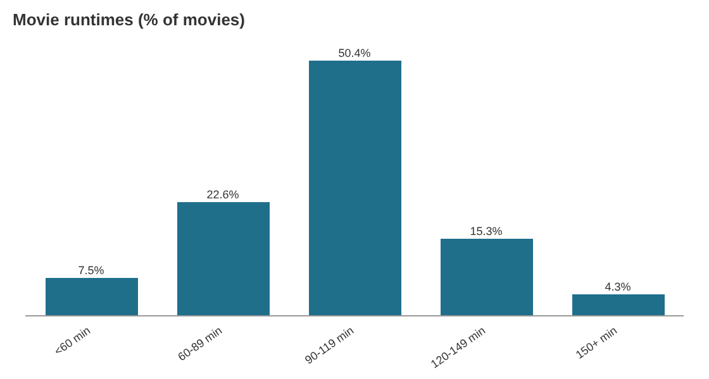
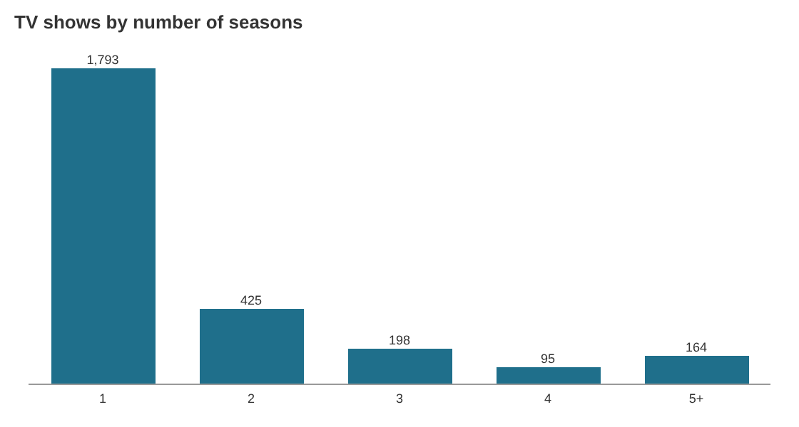
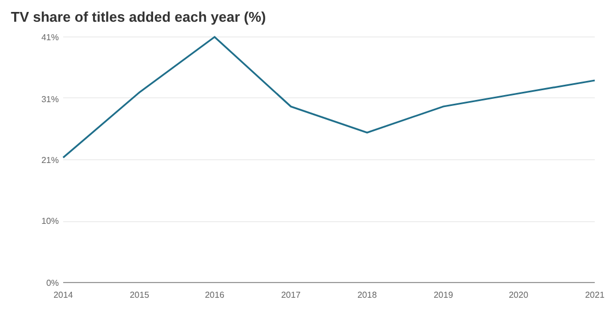

# da-learn-07 · Netflix catalogue analysis (movies and TV shows)

A data-analyst learning project. It analyses **every title listed on Netflix in the well-known Kaggle "Netflix Movies and TV Shows" dataset (8,807 raw rows, snapshot to 25 Sep 2021)**. The raw CSV goes through SQL staging, cleaning (type fixes, repairs, dedupe, multi-value splitting), a star schema with bridge tables, analysis and quality checks. DuckDB runs the whole pipeline locally on the **full** file. The outputs are a Power BI kit plus SVG and PNG charts in `results/images/`.

> **Databricks was skipped** for this project because the Databricks workspace hit its resource quota. There is no live Lakeview dashboard; the SQL stays Databricks/Spark-compatible (DuckDB shims are isolated in `sql/00`), and all charts and KPIs are in [`results/`](results/RESULTS.md).


## Business questions
1. How big is the catalogue, and what is the movie / TV split?
2. How fast did Netflix add titles, and when did TV grow its share?
3. Which countries does the content come from, and how does each country's mix differ?
4. Which genres and maturity ratings dominate?
5. How long are the movies, and how many seasons do shows last?
6. Is the catalogue mostly new releases or back catalogue?
7. How clean is the raw file (duplicates, shifted columns, missing values)?

## Pipeline


## Headline insights (full data, 8,803 clean titles)
- **Mix:** 6,128 movies (**69.6%**) and 2,675 TV shows from 122 countries, 42 genres, 4,993 directors and 36,437 cast members. The median movie runs **98 min** and half of all movies are 90-119 min. **67.0%** of shows have a single season.
- **Growth:** 80.0% of the titles were added from 2018 to Sep 2021. Adds peaked in **2019 with 2,015 titles** (1,423 movies, 592 shows), and TV's share of yearly adds rose from 25.0% in 2018 to 33.7% in 2021. A quarter of all titles (25.2%) landed on the 1st of a month, and 41.2% of January adds did.
- **Countries:** the United States is on 3,689 titles, then India (1,046), the UK (806), Canada (445) and France (393). Only 40.3% of titles with a known country have the US as the first-listed country. India's list is **92.0% movies**, while South Korea (73.6% TV) and Japan (62.6% TV) are mostly series.
- **Audience:** 45.5% of titles are adult-rated (TV-MA, R or NC-17) and only 23.4% are for kids or families. TV-MA alone is 3,203 titles (36.4%). Country profiles differ a lot: Spain's titles are 79.3% adult-rated and Mexico's 68.6%, while India's are mostly teen-rated (55.7% TV-14 or PG-13).
- **Fresh or back catalogue:** 37.0% of titles were added in their release year and 26.1% within 1-2 years, but 13.7% were more than 10 years old when added. Older movies run longer: 1960s films average 147.6 min against 93.6 min for 2020s films.
- **Data quality:** 4 duplicate titles were removed (8,807 to 8,803 rows). 3 Louis C.K. specials had their runtime in the rating column and were repaired. 88 padded dates were trimmed, 10 missing add dates kept as "unknown", and missing director (2,634), cast (825) and country (831) values were kept and flagged. All 17 assertions pass.

## Charts
All charts are in `results/images/` as SVG (plain vector shapes) and PNG (2x render of the same SVG).

| | |
|---|---|
|  |  |
|  |  |
|  |  |
|  |  |

## How to run
```bash
pip install -r requirements.txt
python run_pipeline.py --source sample       # committed 49-title sample in data/raw/, results in results/sample/
python scripts/download_full_data.py         # 3.4 MB into data/raw_full/ (SHA-256 checked, two mirrors)
python run_pipeline.py --source full         # full catalogue: results/, data/clean/, powerbi/data/ (~1 s)
python scripts/render_png.py                 # results/images/*.svg -> *.png with headless Chrome
```
`scripts/make_sample.py` rebuilds the committed sample from the full file.

## Repo layout
```
data/raw/            49-title raw sample (every rating, every add year, all edge cases); full file via scripts/download_full_data.py
data/clean/          cln_titles.csv - the full cleaned, de-duplicated catalogue (8,803 rows)
sql/                 00 DuckDB shims, 01 staging, 02 cleaning, 03 star model, 04 analysis, 05 quality checks
run_pipeline.py      DuckDB runner (sample | full)
scripts/             project config, sample builder, downloader, SVG chart writer, PNG renderer
results/             RESULTS.md, metrics.json, JSON.shot, tables/*.csv, images/*.svg + *.png (dashboard = overview)
powerbi/             full star CSVs, measures.dax, model.md, dashboard_spec.md, BUILD_GUIDE.md
```

## Caveats
- The file is a scrape of what Netflix listed (snapshot to 2021-09-25), not viewing data, so it says nothing about popularity. 2021 is a partial year.
- `release_year` for a TV show is usually the latest season's year, so "added in release year" is inflated for TV (52.2% of shows against 30.4% of movies).
- Country, genre, director and cast are lists. Bridge tables count a co-production once per country, so country totals add up to more than 8,803. "Primary country" is the first one listed.
- Missing directors are common for TV shows (they are usually not credited per show), so director rankings are movie-heavy.
- Netflix genre labels mix format and region ("International TV Shows"), so genre shares overlap.

## Complete dataset
- **Kaggle page:** https://www.kaggle.com/datasets/shivamb/netflix-shows ("Netflix Movies and TV Shows" by Shivam Bansal, last updated 2021-09-27)
- **Mirrors used (exact URLs):**
  - https://huggingface.co/datasets/hugginglearners/netflix-shows/resolve/main/netflix_titles.csv (primary; same 8,807 rows, final newline dropped, 3,399,670 B, SHA-256 `b5e2528a…6ce959`)
  - https://huggingface.co/datasets/harshi321/netflix-movies_shows/resolve/main/netflix_titles.csv (fallback; 3,399,671 B, the same size as the Kaggle file, SHA-256 `df1f4ad2…6f3f3`)
- **Licence:** CC0: Public Domain (Kaggle listing; the Hugging Face mirror is tagged cc0-1.0)
- **Total size:** 3,399,671 bytes (~3.4 MB) on Kaggle
- **Files:** `netflix_titles.csv` only: 8,807 rows × 12 columns (`show_id, type, title, director, cast, country, date_added, release_year, rating, duration, listed_in, description`)
- **Download:** `python scripts/download_full_data.py` (writes to data/raw_full/ and verifies SHA-256)
