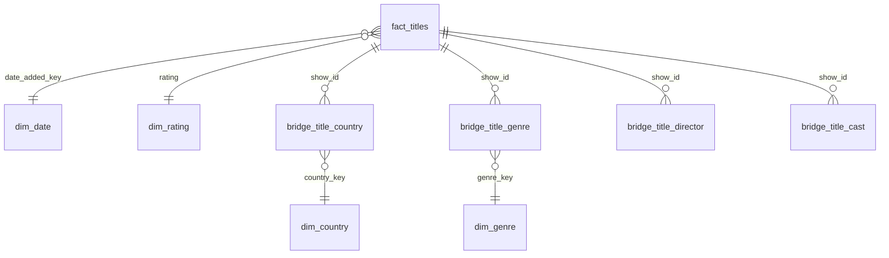

# Power BI model - da-learn-07 Netflix catalogue

Import every CSV in `powerbi/data/` (full data, 8,803 titles; built by `python run_pipeline.py --source full`).

| Table | Grain | Key | Notes |
|---|---|---|---|
| fact_titles | one catalogue title | show_id | type, release year, rating, minutes / seasons, primary country, age at add band, DQ flags |
| dim_date | date added | date_key (yyyymmdd) | `-1` = date unknown (10 titles) |
| dim_rating | rating | rating | audience group (Kids, Older kids / family, Teens, Adults, Not rated) and rating system |
| dim_country | country | country_key | 122 countries |
| dim_genre | Netflix genre | genre_key | 42 genres; genre_family = TV or Movie genre (data-driven) |
| bridge_title_country | title x country | show_id, country_key | `is_primary` = first listed country |
| bridge_title_genre | title x genre | show_id, genre_key | up to 3 per title |
| bridge_title_director | title x director | show_id | names as text |
| bridge_title_cast | title x cast member | show_id | names as text |

## Relationships
- `fact_titles[date_added_key]` -> `dim_date[date_key]` (many-to-one, single direction)
- `fact_titles[rating]` -> `dim_rating[rating]` (many-to-one)
- `bridge_title_country[show_id]` -> `fact_titles[show_id]` (many-to-one, **both** directions so a country slicer filters titles)
- `bridge_title_country[country_key]` -> `dim_country[country_key]` (many-to-one)
- the same pattern for `bridge_title_genre` + `dim_genre`; director and cast bridges link to `fact_titles[show_id]`
- Sort `dim_date[month_label]` by `dim_date[month]`. Band columns (`age_at_add_band`, `runtime_band`) carry a numeric prefix so they sort correctly.
