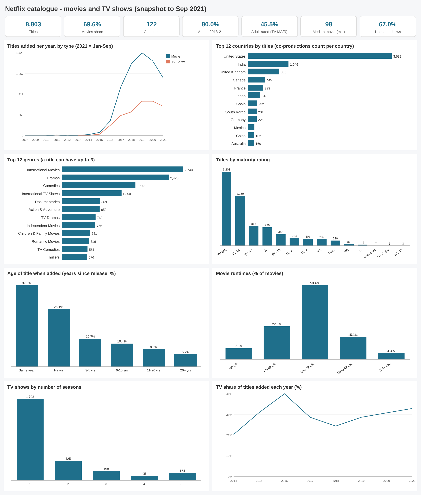

# Results - da-learn-07 Netflix catalogue

Run: `python run_pipeline.py --source full` on DuckDB (local, full file, 8,807 raw rows). Databricks was skipped because the workspace hit its resource quota, so there is no live dashboard; every number below is in `metrics.json` and `tables/`.

## Headline KPIs
| KPI | Value |
|---|---|
| Titles (clean) | 8,803 (6,128 movies, 2,675 TV shows) |
| Movie share | 69.61% |
| Countries / genres | 122 / 42 |
| Directors / cast members | 4,993 / 36,437 |
| Added 2018 to Sep 2021 | 79.95% |
| Adult-rated (TV-MA, R, NC-17) | 45.50% |
| Median / average movie runtime | 98 / 99.6 min |
| Single-season shows | 67.03% (avg 1.76 seasons) |
| Added in release year | 37.02% (median gap 1 year) |
| First-listed country = US (of known) | 40.27% |
| Add dates | 2008-01-01 to 2021-09-25 |

## Titles added per year
| Year | Titles | Movies | TV | TV share | Non-US primary |
|---|---|---|---|---|---|
| 2015 | 82 | 56 | 26 | 31.7% | 30.5% |
| 2016 | 429 | 253 | 176 | 41.0% | 53.9% |
| 2017 | 1,188 | 839 | 349 | 29.4% | 60.5% |
| 2018 | 1,649 | 1,237 | 412 | 25.0% | 62.3% |
| 2019 | 2,015 | 1,423 | 592 | 29.4% | 54.0% |
| 2020 | 1,879 | 1,284 | 595 | 31.7% | 56.5% |
| 2021 (Jan-Sep) | 1,495 | 991 | 504 | 33.7% | 40.0% |

## Top countries (a co-production counts for each country)
| Country | Titles | Movie % | Adult-rated % | Teen-rated % |
|---|---|---|---|---|
| United States | 3,689 | 74.6% | 47.7% | 25.2% |
| India | 1,046 | 92.0% | 25.9% | 55.7% |
| United Kingdom | 806 | 66.3% | 49.4% | 23.2% |
| Canada | 445 | 71.7% | 42.0% | 18.2% |
| France | 393 | 77.1% | 56.2% | 21.1% |
| Japan | 318 | 37.4% | 34.6% | 34.0% |
| Spain | 232 | 73.7% | 79.3% | 9.9% |
| South Korea | 231 | 26.4% | 40.7% | 37.7% |

## Content profile
- **Genres:** International Movies 2,749 (31.2% of titles), Dramas 2,425, Comedies 1,672, International TV Shows 1,350, Documentaries 869.
- **Ratings:** TV-MA 3,203, TV-14 2,160, TV-PG 863, R 799, PG-13 490. Audience groups: adults 45.5%, teens 30.1%, older kids / family 13.1%, kids 10.3%.
- **Movie runtimes:** <60 min 7.5%, 60-89 min 22.6%, 90-119 min 50.4%, 120-149 min 15.3%, 150+ min 4.3%. Average runtime falls from 147.6 min (1960s releases) to 96.9 (2010s) and 93.6 (2020s).
- **Seasons:** 1 season 1,793 shows (67.0%), 2 seasons 425, 3 seasons 198, 4 seasons 95, 5+ seasons 164.
- **Age when added:** same year 37.0%, 1-2 yrs 26.1%, 3-5 yrs 12.7%, 6-10 yrs 10.4%, 11-20 yrs 8.0%, 20+ yrs 5.7%.
- **Most frequent people:** directors Rajiv Chilaka (22), Jan Suter (21), Raúl Campos (19); cast Anupam Kher (43), Shah Rukh Khan (35), Julie Tejwani (33).
- **Release calendar:** 25.2% of titles were added on the 1st of a month (41.2% in January); December (813) and July (827) are the busiest months.

## Data quality (tables/dq_issues.csv, tables/dq_assertions.csv)
| Check | Rows |
|---|---|
| duplicate title (same title, type, release year, director), removed | 4 |
| runtime stored in rating column, moved to duration | 3 |
| date_added with leading spaces, trimmed | 88 |
| date_added missing, kept as unknown (-1) | 10 |
| director / cast / country missing, kept | 2,634 / 825 / 831 |
| country list with a stray comma, fixed | 7 |
| release year later than year added, flagged | 14 |
| movie runtime < 20 or > 240 min, flagged | 29 |
| NR and UR merged into NR | 83 |
| **assertions passed** | **17 / 17** |

## Images
How they were made: `run_pipeline.py` queries the `a_*` tables in DuckDB and writes each chart as an SVG with plain vector shapes (`scripts/svgcharts.py`, no embedded rasters); `scripts/render_png.py` then rasterises each SVG at 2x with headless Chrome.

| File | Shows |
|---|---|
| [dashboard.svg](images/dashboard.svg) / [png](images/dashboard.png) | KPI cards + all 8 charts |
| [titles_added_by_year.svg](images/titles_added_by_year.svg) / [png](images/titles_added_by_year.png) | titles added per year by type |
| [top_countries.svg](images/top_countries.svg) / [png](images/top_countries.png) | top 12 countries |
| [top_genres.svg](images/top_genres.svg) / [png](images/top_genres.png) | top 12 genres |
| [rating_mix.svg](images/rating_mix.svg) / [png](images/rating_mix.png) | titles by maturity rating |
| [content_age_at_add.svg](images/content_age_at_add.svg) / [png](images/content_age_at_add.png) | years between release and add |
| [movie_runtime_bands.svg](images/movie_runtime_bands.svg) / [png](images/movie_runtime_bands.png) | movie runtime bands |
| [tv_seasons.svg](images/tv_seasons.svg) / [png](images/tv_seasons.png) | shows by season count |
| [tv_share_by_year.svg](images/tv_share_by_year.svg) / [png](images/tv_share_by_year.png) | TV share of yearly adds |

Other files: `metrics.json` (all KPIs, DQ and analysis tables), `JSON.shot` (headline snapshot + run config), `tables/*.csv` (every `a_*` and `dq_*` table, top 500 rows).
